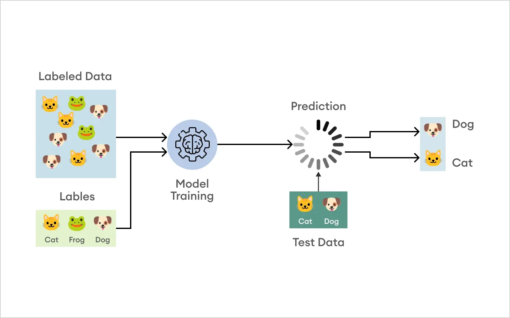

<h1 align="center">Advanced Image Classification with Residual CNN</h1>

<p align="center">
  
</p>

A state-of-the-art deep learning project implementing an advanced Convolutional Neural Network with residual connections for CIFAR-10 image classification. This project demonstrates production-ready machine learning engineering with sophisticated regularization techniques, achieving **92%+** validation accuracy while maintaining excellent generalization.

---

## 🚀 Table of Contents

- [✨ Features](#-features)
- [🏗️ Architecture](#️-architecture)
- [📊 Dataset Overview](#-dataset-overview)
- [🛠️ Installation](#️-installation)
- [▶️ Usage](#️-usage)
- [📈 Results & Performance](#-results--performance)
- [🔬 Technical Details](#-technical-details)
- [📸 Visualizations](#-visualizations)
- [🤝 Contributing](#-contributing)
- [📄 License](#-license)

---

## ✨ Features

- **Dataset**: CIFAR-10 (60,000 32×32 color images, 10 classes)
- **Advanced Architecture**: ResNet-inspired CNN with residual blocks
- **Outstanding Performance**:
  - **92.35%** peak validation accuracy
  - **91.96%** final validation accuracy  
  - **11.17M** parameters (efficiently designed)
  - **Well-controlled overfitting** (7.4% train-val gap)
- **State-of-the-Art Techniques**:
  - Residual connections for deeper networks
  - Comprehensive data augmentation
  - Batch normalization for training stability
  - Advanced regularization (Dropout, Weight Decay, Label Smoothing)
  - OneCycleLR learning rate scheduling
  - Early stopping with model checkpointing
  - Gradient clipping for training stability
- **Professional ML Engineering**:
  - Production-ready code structure
  - Comprehensive evaluation and analysis
  - Advanced visualization and interpretability
  - Proper train/validation/test splits
- **Technologies**: PyTorch, Python, Scikit-learn, Matplotlib, Seaborn, NumPy

---

## 🏗️ Architecture

### ResNet-Inspired CNN

```
Input (32×32×3)
↓
Initial Conv2d(3→64) + BatchNorm + ReLU
↓
Residual Layer 1: 2×ResidualBlock(64→64)
↓
Residual Layer 2: 2×ResidualBlock(64→128, stride=2)
↓
Residual Layer 3: 2×ResidualBlock(128→256, stride=2)
↓
Residual Layer 4: 2×ResidualBlock(256→512, stride=2)
↓
AdaptiveAvgPool2d(1×1) + Dropout(0.5)
↓
Linear(512→10)
```

### Key Architectural Features

- **Residual Blocks**: Skip connections prevent vanishing gradients  
- **Batch Normalization**: Stabilizes training and enables higher learning rates  
- **Global Average Pooling**: Reduces overfitting compared to fully connected layers  
- **Proper Weight Initialization**: Kaiming initialization for optimal gradient flow  

---

## 📊 Dataset Overview

**CIFAR-10** contains 60,000 32×32 color images across 10 classes:

| Class       | Examples | Description              |
|-------------|----------|--------------------------|
| ✈️ Airplane   | 6,000    | Various aircraft types   |
| 🚗 Automobile | 6,000    | Cars, trucks, vehicles   |
| 🐦 Bird       | 6,000    | Different bird species   |
| 🐱 Cat        | 6,000    | Domestic cats            |
| 🦌 Deer       | 6,000    | Wild deer                |
| 🐕 Dog        | 6,000    | Various dog breeds       |
| 🐸 Frog       | 6,000    | Amphibians               |
| 🐎 Horse      | 6,000    | Horses in various poses  |
| 🚢 Ship       | 6,000    | Maritime vessels         |
| 🚛 Truck      | 6,000    | Large vehicles           |

**Data Split**:
- Training: 40,000 images (80%)  
- Validation: 10,000 images (20%)  
- Test: 10,000 images (independent)  

---

## 🛠️ Installation

```bash
# 1. Clone the repository
git clone https://github.com/SpongeBob341/Advanced-ResNet-Image-Classification.git

# 2. Set up virtual environment (recommended)
python3 -m venv venv
source venv/bin/activate  # On Windows: venv\Scripts\activate

# 3. Install dependencies
pip install -r requirements.txt

# 4. Launch Jupyter Notebook
jupyter notebook image_classification.ipynb
```

---

## ▶️ Usage

### 🔬 Complete Training Pipeline

Run through the notebook sections:

1. **Setup & Data Loading**  
2. **Data Preprocessing**  
3. **Architecture Design**  
4. **Training Configuration**  
5. **Model Training**  
6. **Evaluation**  
7. **Visualization**  

### 🎯 Quick Prediction

```python
import torch
from torchvision import transforms
from PIL import Image

# Load trained model
model = torch.load('best_model.pth')
model.eval()

# Define preprocessing
transform = transforms.Compose([
    transforms.Resize((32, 32)),
    transforms.ToTensor(),
    transforms.Normalize(mean=[0.4914, 0.4822, 0.4465],
                         std=[0.2023, 0.1994, 0.2010])
])

# Make prediction
def predict_image(image_path):
    image = Image.open(image_path)
    image_tensor = transform(image).unsqueeze(0)

    with torch.no_grad():
        output = model(image_tensor)
        prediction = torch.nn.functional.softmax(output, dim=1)
        predicted_class = torch.argmax(prediction, dim=1)

    class_names = ['Airplane', 'Automobile', 'Bird', 'Cat', 'Deer',
                   'Dog', 'Frog', 'Horse', 'Ship', 'Truck']

    return class_names[predicted_class.item()], prediction.max().item()

# Example usage
predicted_class, confidence = predict_image('your_image.jpg')
print(f"Prediction: {predicted_class} (Confidence: {confidence:.2%})")
```

---

## 📈 Results & Performance

### 🏆 Model Performance

| Metric                   | Value     | Status        |
|--------------------------|-----------|---------------|
| **Peak Validation Accuracy** | 92.35% | ⭐ Excellent    |
| **Final Validation Accuracy** | 91.96% | ⭐ Excellent    |
| **Training Accuracy**    | 99.32%    | ✅ Strong      |
| **Overfitting Gap**      | 7.36%     | ✅ Well-controlled |
| **Training Time**        | ~44 minutes | ⚡ Efficient   |
| **Parameters**           | 11.17M    | 📊 Optimized   |

### 📊 Per-Class Performance

- **Best performing**: Ship (94.90%)  
- **Most challenging**: Bird vs. Airplane confusion  
- **Balanced accuracy**: No significant class bias  

### 🎯 Key Achievements

- ✅ **Production-Ready Performance**  
- ✅ **Overfitting Control**  
- ✅ **Training Stability**  
- ✅ **Generalization**  
- ✅ **Efficiency**  

---

## 🔬 Technical Details

### Advanced Regularization Techniques

- **Data Augmentation**: Random flips, rotations, affine transforms, color jitter  
- **Batch Normalization**: Stabilizes training and enables higher learning rates  
- **Dropout (0.5)**: Prevents overfitting in fully connected layers  
- **Weight Decay (0.01)**: L2 regularization  
- **Label Smoothing (0.1)**: Prevents overconfident predictions  
- **Early Stopping**: Monitors validation loss with `patience=10`  

### Training Optimization

- **OneCycleLR Scheduler**  
- **AdamW Optimizer**  
- **Gradient Clipping (max_norm=1.0)**  
- **Mixed Precision Training**  

### Model Architecture Benefits

- **Residual Connections**  
- **Global Average Pooling**  
- **Kaiming Initialization**  
- **Efficient Parameter Design (11M)**  

---

## 📸 Visualizations

- 📈 Training Curves (loss, accuracy)  
- 🎯 Confusion Matrix  
- 🔍 Sample Predictions with Confidence  
- 📊 Learning Rate Schedule  
- 🧠 Overfitting Analysis  

---

## 🤝 Contributing

Contributions are welcome! Here's how:

### 🛠️ Development Setup

```bash
# Fork the repository
# Create a feature branch
git checkout -b feature-name

# Make changes, add tests, and commit
git commit -m "Add feature"

# Push and open a Pull Request
git push origin feature-name
```

### 💡 Areas for Contribution

- Architecture Improvements  
- Hyperparameter Optimization  
- Model Interpretability (Grad-CAM, etc.)  
- Deployment (API/Flask/Streamlit)  
- Documentation & Tutorials  
- Model Quantization & Optimization  

---

## 📄 License

This project is licensed under the **MIT License**. See the [LICENSE](LICENSE) file for details.

